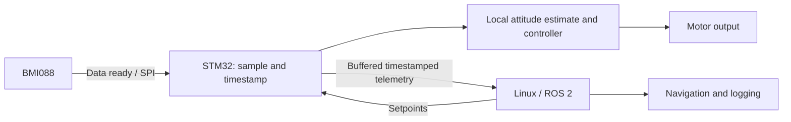

# UNO Q IMU transport benchmark: results and engineering assessment

Recorded run: **2026-10-23, 20:29:25 UTC**. This report separates the supplied measurements from design recommendations. The app completed 66 stages and exited with code 0.

**Assessment:** UNO Q's MCU/Linux split is a promising arrangement for robotics when sensor acquisition and the fast feedback loop remain on the STM32, while Linux runs ROS, navigation and supervision. This run does not validate a balancing controller or navigation accuracy. It shows that the current one-sample-per-RPC implementation is a throughput constraint.

## Evidence saved with this report

- [console.log](console.log): byte-identical copy of the user-supplied output.
- [stages_from_console.csv](stages_from_console.csv): 66 parsed stage records.
- [summary_from_console.json](summary_from_console.json): per-target aggregates and source SHA-256.

The CSV and JSON are reconstructed from rounded console values. They are **not** the original on-board `stages.csv` or `summary.json`. Exact counts, RPC percentiles, overrun timing, software versions, board RAM variant and actual command-line settings are absent from the supplied log. Stage duration and QoS are described by the app defaults; the log alone does not independently confirm them.

## What the run measured

| Path / target | Received Hz across three repeats | Reported loss | Interpretation |
| --- | --- | --- | --- |
| Bridge, 75 Hz | 74.9–75.0 | 0.00% | Highest tested target passing every repeat |
| Bridge, 100 Hz | 93.3–93.7 | 0.00% | Below the 95% target-rate threshold |
| Bridge, unthrottled | 93.5–93.9; mean 93.7 | 0.00% | Observed saturation for this implementation |
| ROS-only, 400 Hz | 399.9–400.0 | 0.00% | Highest tested target passing every repeat |
| ROS-only, 800 Hz | 481.7–487.7 | 37.79–38.54% | Receiver path overloaded |
| ROS-only, 1600 Hz | 455.7–458.7 | 70.70–70.89% | Higher offered load reduces delivered throughput |
| ROS-only, unthrottled | 434.1–438.0 | 85.54–85.60% | About 3083–3097 publications/s does not imply successful delivery |

Every logged stage reports zero application errors. Unthrottled stages deliberately have `pass=False`, because they have no paced target to validate.

**75 Hz is the highest passing tested Bridge target, not its exact sustainable ceiling.** No rates between 75 and 100 Hz were tested. Similarly, 400 Hz is a demonstrated ROS-only point; the best sustainable target between 400 and 800 Hz remains unknown.

Bridge delivery plateaus around 93–94 Hz even when the requested rate increases. Since the ROS-only path passes at 400 Hz, the additional synchronous RPC path is the strongest bottleneck candidate. This experiment does not isolate how that cost divides among the MCU callback, safe-callback dispatch, router, serialization, Linux scheduling and Python client. It does not establish a fundamental UNO Q hardware limit.

The reciprocal of 93.7 Hz is approximately **10.7 ms per completed cycle**. This is a throughput-derived interval, **not a measured one-way latency or worst-case deadline**. Average rates cannot reveal long scheduling gaps. The receiver itself uses Python callbacks, pipe polling and a set of message IDs; its overhead also contributes to ROS-only saturation. The ROS-only result is not a universal DDS ceiling.

Zero reported loss means no missing host publications were detected by the drain deadline at the displayed precision. It does not prove that every physical IMU sample was acquired: the benchmark uses dummy values and a **host publication counter**. No sensor acquisition counter exists in this experiment.

## What this means for navigation

For a slowly moving wheeled robot, this is enough evidence to justify evaluating a 50–75 Hz ROS IMU stream together with wheel odometry and another suitable reference. It is not enough evidence to claim navigation-grade performance. The project's previous real-BMI088 observation of roughly 65–68 Hz at a 100 Hz target is consistent with additional acquisition/application overhead, but it came from a different run and is not a controlled subtraction.

Navigation quality also depends on sensor noise and bias, calibration, vibration, filtering, axis conventions, covariance and synchronization. The [Kalibr IMU noise model](https://github.com/ethz-asl/kalibr/wiki/IMU-Noise-Model) explicitly models noise and slowly varying bias. [Nav2's localization guide](https://github.com/ros-navigation/docs.nav2.org/blob/rolling/docs/configuration_and_development/first_time_robot_setup_guide/odom/setup_robot_localization.md) describes combining wheel encoders and IMU data for odometry. An IMU alone does not provide drift-free position.

For fast motion or tightly coupled visual-inertial estimation, this specific transport is a concern: it cannot deliver even a requested 100 Hz consistently under the benchmark's criteria. Requirements must come from the chosen estimator and motion dynamics. A timestamp assigned on Linux after an RPC is not the physical acquisition timestamp; variable transport delay can misalign IMU and camera/encoder observations.

## What this means for balancing

**I would keep the balancing feedback loop on the STM32.** The current Linux/RouterBridge round trip has no demonstrated latency bound, jitter bound or sensor-to-actuator timing measurement. A simple slow plant might balance through such a path, but these logs cannot establish its stability or robustness.

Arduino documents the [UNO Q architecture](https://docs.arduino.cc/hardware/uno-q/) as a Linux QRB2210 MPU paired with a STM32U585 MCU running Arduino over Zephyr. This division makes it possible to design local real-time acquisition and control alongside Linux processing. Determinism still depends on the actual firmware, priorities, drivers and workload; it is not automatically guaranteed by using an MCU.

Proposed division of work, not implemented by this benchmark:

Choose the MCU control frequency from the mechanical plant and controller design; a candidate evaluation point could be 500 Hz, but this benchmark has **not** demonstrated it. Linux can publish navigation goals and setpoints while the MCU maintains the local loop and handles stale-command behavior.

## Changes needed for high-quality IMU delivery

1. Acquire independently of Linux requests, using data-ready interrupts or a suitable FIFO scheme. Record an acquisition sequence and MCU timestamp for every sample.
2. Validate accelerometer/gyro synchronization. Bosch's [BMI08x synchronization application note](https://www.bosch-sensortec.com/media/boschsensortec/downloads/application_notes_1/bst-mis-an006.pdf) describes asynchronous acquisition and a synchronization mechanism with filter-delay considerations. Reading both devices in one function is insufficient evidence of synchronized measurements.
3. Send timestamped batches or evaluate streaming transport to amortize per-call overhead. Larger packets change the measured cost; batching performance must be measured. Batching also adds delivery delay, so keep local control independent.
4. Map the MCU time base into ROS time and characterize clock offset/drift. Preserve acquisition time through the transport.
5. Calibrate biases, scale/alignment and temperature effects; check vibration and aliasing. Publish appropriate frame transforms and measured covariance information.
6. Measure acquisition jitter and sensor-to-estimator and sensor-to-actuator latency distributions, including worst observed gaps, under representative camera, CPU and network load. Verify deadline misses, buffer overflows and estimator/control performance using real sensor data.

The next narrow experiments are a 75–100 Hz Bridge refinement, a 400–800 Hz ROS-only refinement, and retrieval of the original on-board result files with RPC timings. Those would clarify the software ceiling. A timestamped real-IMU test and a local MCU control-loop timing test are needed to assess navigation and balancing quality.

## Relationship to the source project

The [BMI088 integration](https://github.com/mauringo/bosch-sensortec-ros2-unoq) answers “Can the sensor reach ROS 2 on UNO Q?” This companion benchmark asks “What limits delivery before sensor work is added, and what architecture should a robot use?” Both projects serve different stages of the same investigation. The persistent MessagePack client is reused under the source project's MIT license.
